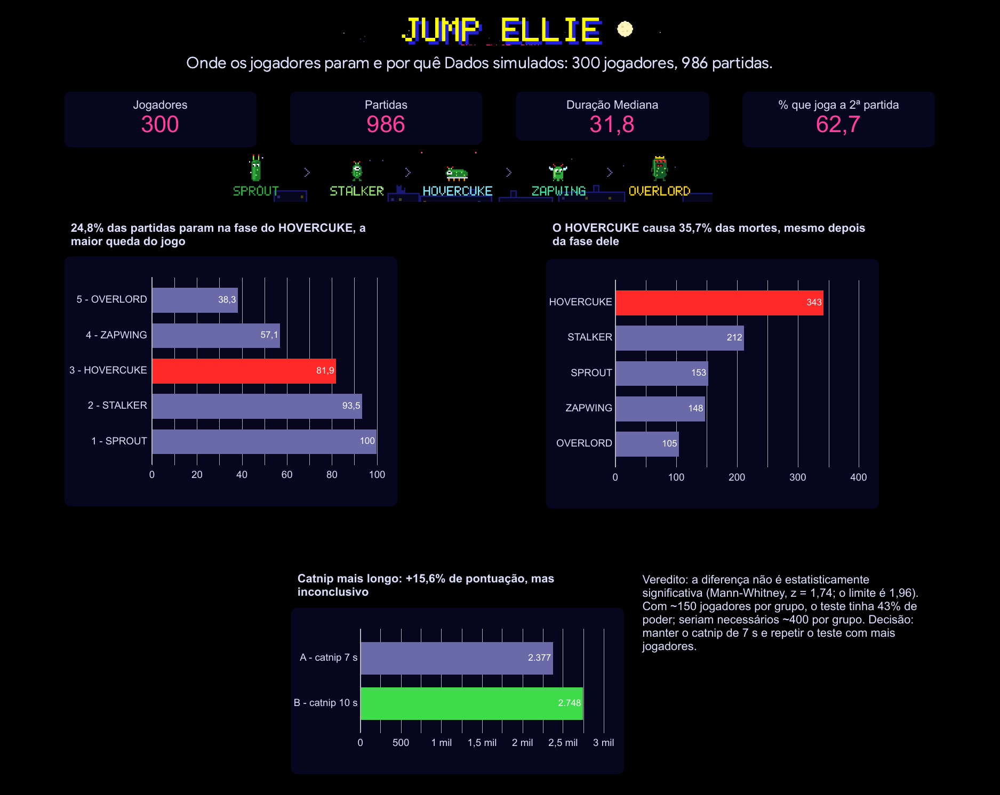

# Jump Ellie — Game Analytics

**Where do players stop, and why?** An end-to-end game analytics project built on my own browser game, *Jump Ellie*: event tracking, a data pipeline in Google Cloud, SQL analysis in BigQuery, an A/B test and a Looker Studio dashboard.

- ▶️ **Play the game:** [brunaclima.github.io/jump-ellie-play](https://brunaclima.github.io/jump-ellie-play)
- 📊 **Dashboard:** [Jump Ellie — Game Analytics (Looker Studio)](https://datastudio.google.com/s/s5rsVKJp4to)
- 🗂️ **SQL:** [`sql/`](sql/) — every query, in the order I ran them



> **About the data.** All numbers come from **simulated players** (300 players, 6,335 events), generated by a script that follows the game's real rules. I chose simulated data on purpose: the goal of this project is the full analytics workflow — tracking design, pipeline, data cleaning, metrics, experimentation and communication — not conclusions about real players. See [What simulated data can and can't tell](#what-simulated-data-can-and-cant-tell).

---

## TL;DR

| Question | Answer |
|---|---|
| Where is the game hardest? | **HOVERCUKE**, the 3rd villain. 24.8% of matches end at its stage — the biggest drop in the game — and it causes **35.7% of all deaths**. |
| Do people play again? | **62.7%** of sessions reach a 2nd match, **37.3%** a 3rd. About 4 in 10 sessions end after the first death. |
| Who quits? | Players who quit after the first match **died earlier** in it: ~9 s shorter and ~940 fewer points (median). |
| Does a longer catnip power-up help? | Group B (10 s) scored **15.6% more** than A (7 s), but the result is **not significant** (z = 1.74). Inconclusive — the test had only 43% power. |

**Recommendations:** rebalance HOVERCUKE (slower or easier to jump), smooth the early game to protect retention, and keep the 7 s catnip until the A/B test is re-run with ~400 players per group.

---

## The game

*Jump Ellie* is an endless runner: Ellie the cat jumps over villains that evolve as the score grows — **SPROUT → STALKER → HOVERCUKE → ZAPWING → OVERLORD** (at 400, 1,200, 2,500 and 4,500 points). Speed increases over time. A **catnip** power-up makes Ellie invincible for a few seconds.


## Questions and my guesses (written before looking at the data)

I wrote down a hypothesis for each question first, so I could not adjust them to fit the results.

| Question | Metric | My guess | What the data showed |
|---|---|---|---|
| Do people play again? | % of sessions with a 2nd and 3rd match | 80% play a 2nd, 60% a 3rd | 62.7% and 37.3%. I was ~20 points too optimistic. |
| Where do most players stop? | Deaths by stage and by villain | Speed is the problem, not a specific villain | Partly wrong: one villain, HOVERCUKE, is the bottleneck. |
| How long is a match? | Median match duration | 60 s | **31.8 s.** Players die much earlier than I imagined. |
| Does a longer catnip help? | Median score per player, A vs B | A (7 s) scores 30% more: a long catnip carries you into a faster section and you die right after it ends | The opposite direction (B +15.6%), but not significant. |

The A/B decision metric — **median score per player** — was fixed before seeing the result.

---

## Pipeline

```
Game (HTML/JS)  ──POST JSON──▶  Google Apps Script (web app)  ──▶  Google Sheets  ──▶  BigQuery (external table)  ──▶  Looker Studio
                                 validates and rate-limits           raw events          SQL views and tables          dashboard
```

- **Tracking plan** — 5 events: `partida_inicio` (match start), `catnip`, `evolucao` (villain evolution), `morte` (death) and `abandono` (quit). Each event carries player, session and match IDs, A/B variant, score, seconds since the match started, the villain and the current stage.
- **Collector** — [`telemetry/Code.gs`](telemetry/Code.gs): an Apps Script web app that validates every field (event names, ID format, value ranges, required fields per event), rejects bad events, limits each player to 300 events per minute and writes timestamps in UTC as text, so BigQuery reads them as `TIMESTAMP` without conversion.
- **Simulator** — [`simulator/simulador.py`](simulator/simulador.py): generates players with four skill profiles (beginner, casual, good, expert) that play match by match under the game's rules — speed curve, evolution thresholds, catnip timing and the A/B variant. Some players come back on later days in new sessions. Seed 42, 14 days.
- **Warehouse** — BigQuery reads the sheet as an external table. The view [`partidas`](sql/08_view_matches.sql) turns the event log into **one row per match**; every analysis query reads from it.

### Data dictionary (column names are in Portuguese)

| Column | Meaning |
|---|---|
| `jogador_id`, `sessao_id`, `partida_id` | player, session (one opening of the game) and match IDs |
| `variante` | A/B group: A = 7 s catnip, B = 10 s catnip |
| `fonte` | source: `simulado` (simulated), `teste` (my manual tests), `real` |
| `evento` | event name (see tracking plan) |
| `pontuacao`, `duracao_s` | score and seconds since the match started |
| `vilao`, `nivel` | villain that killed / evolved, and the stage the match was in |
| `pontuacao_final`, `vilao_que_matou`, `terminou`, `ordem_na_sessao` | in the `partidas` view: final score, killer villain, match ended in a death, 1st/2nd/3rd match of the session |

---

## Findings

### 1. The typical player is much smaller than the average suggests

| Metric | Median | Mean |
|---|---|---|
| Matches per player | 2 | 3.29 |
| Final score | ~3,008 | 6,757 |
| Match duration | 31.8 s | 44.5 s |

In all three, a small, very active minority pulls the mean up: the most active player played 19 matches, and the top score (157,455) is 23× the mean. **51.7%** of players played at most 2 matches. That is normal in games, so the **median is my main measure** throughout.

Half of all matches last between **17.7 and 55.7 s** (p25–p75).

### 2. HOVERCUKE is the bottleneck

| Stage | % of matches that reached it |
|---|---|
| 1 — SPROUT | 100.0% |
| 2 — STALKER | 93.5% |
| 3 — HOVERCUKE | 81.9% |
| 4 — ZAPWING | 57.1% |
| 5 — OVERLORD | 38.3% |

81.9% of matches reach HOVERCUKE's stage, but only 57.1% get past it: **24.8 points lost**, the largest drop in the funnel.

Stage and speed grow together, so the funnel alone can't separate "this villain is hard" from "the game is getting fast". To split them, I looked at **who actually killed Ellie** instead of which stage the match was in: HOVERCUKE causes **35.7% of all deaths** (343 of 961) — more than the matches that end at its stage — because it keeps killing in the ZAPWING and OVERLORD stages. If speed were the only problem, deaths would be spread across villains.

*(The 38.3% at OVERLORD is not a difficulty signal: it is the last stage, so every match that gets there ends there.)*

### 3. Retention: early deaths and quitting go together

Of 397 sessions, **62.7%** reach a 2nd match and **37.3%** a 3rd.

Sessions that ended after one match had a **worse first match**: about 9 s shorter and ~940 fewer points (median) than sessions where the player tried again.

This is a **correlation**. Dying early may cause quitting, or a third factor — being a beginner — may explain both. Confirming it would take an experiment.

**The story that ties findings 2 and 3:** HOVERCUKE knocks players out early, and players who die early are more likely to quit. Making the early game smoother is the most promising lever for retention.

### 4. A/B test: catnip 7 s vs 10 s — inconclusive

| Group | Players | Median score per player |
|---|---|---|
| A — catnip 7 s | 161 | 2,377 |
| B — catnip 10 s | 133 | 2,748 (+15.6%) |

- **Test:** Mann-Whitney U, written in SQL ([`sql/15_ab_mann_whitney.sql`](sql/15_ab_mann_whitney.sql)): every A player is compared with every B player. B wins in 55.9% of pairs; **z = 1.74**, below the 1.96 threshold for 95% confidence. I chose a rank test because scores are very skewed.
- **Sample ratio check (SRM):** 165 players were assigned to A and 135 to B. A fair 50/50 split gives a difference this large 9.4% of the time (binomial test), above the 1% alarm level, so the randomization is fine.
- **Power:** resampling the data in Python, a test with ~150 players per group detects this difference only **43%** of the time. Reaching 80% power needs **~400 players per group**.

| Players per group | Chance of detecting the difference |
|---|---|
| ~150 (this test) | 43% |
| 250 | 62% |
| 300 | 72% |
| 400 | 83% |
| 500 | 89% |

**Decision:** keep the 7 s catnip and re-run the test with more players before changing the game. You don't change a product based on a result that may be luck.

---

## Data quality: six issues found and how I handled them

None of them changes the conclusions, but every one is documented.

| # | Issue | How I found it | Decision |
|---|---|---|---|
| 1 | 10 matches started and never ended (986 starts vs 961 deaths + 15 quits) | Pivot table in Sheets | Count them as played (for retention), exclude them from score and duration |
| 2 | 1 catnip event missing (1,717 of 1,718) | Comparing SQL counts with the original file | Proceed; likely deleted together with a duplicated header row |
| 3 | Events dated after the day of the analysis | Events-per-day query | Keep and document: the simulator generated 14 days |
| 4 | Header row repeated in the middle of the data | BigQuery error: *Could not parse 'recebido_em' as a timestamp* | Removed the row in the sheet |
| 5 | Grouping by match returned 988 rows instead of 986 | Row-count check after building the view | Two `partida_id` cells had been changed by an accidental cut/paste; fixed and re-validated. **Lesson: never edit raw data by hand.** |
| 6 | `APPROX_QUANTILES` returned different medians on each run (2,614 vs 2,748) | Re-running the A/B query for the dashboard | Switched to `PERCENTILE_CONT`, which is exact. **Lesson: run twice and compare.** |

Other rules I followed:
- Always filter `fonte = 'simulado'` — without it, my manual test matches quietly changed the mean score, with no error.
- Final score comes only from `morte` events; other events carry the score at that moment.
- I validated the `partidas` view against a match I had read by hand in the spreadsheet (variant, catnips, evolutions, score, duration, killer).

---

## Dashboard

Built in Looker Studio on small pre-aggregated BigQuery tables ([`sql/16_dashboard_tables.sql`](sql/16_dashboard_tables.sql)), so the dashboard numbers match the analysis exactly.

- **Action titles:** each chart's title states its finding (*"24.8% of matches stop at HOVERCUKE's stage"*) instead of just naming the metric.
- **Game-themed design:** night background and the game's palette; HOVERCUKE highlighted in red and the catnip group in green, so the eye goes to the finding first.

---

## What simulated data can and can't tell

The simulator encodes my assumptions about how the game is played — for example, how dangerous each villain is and how likely each skill profile is to play again. So these findings describe **the simulated game**, not real players: HOVERCUKE being the bottleneck partly reflects the difficulty I gave it in the simulator.

What the project *does* show is the method. The same pipeline and queries run unchanged on real data: the game already sends events with `fonte = 'real'` when tracking is turned on. With real players, the first things I would check are whether the HOVERCUKE drop holds and whether the A/B result changes with ~400 players per group.

---

## What I would do next

- Measure **time between the end of a catnip and death**, to test my "catnip trap" hypothesis directly.
- See where the 10 unfinished matches stopped.
- Try to **recover the hidden skill profiles** from behavior alone (clustering).
- Collect real players and re-run the A/B test with enough power.

---

## How I worked (and where AI helped)

I used AI (Claude Code) as a pair: it built the Apps Script collector and the player simulator, and from the match-table step onward it drafted the SQL queries. My part was the analysis itself: I defined the questions and wrote my hypotheses before seeing the data, explored the raw events by hand in the spreadsheet, ran every query and validated the results against manual counts, found and fixed the six data-quality issues, interpreted the findings, made the A/B test decision and designed the dashboard.

## Tools

Google Apps Script · Google Sheets · BigQuery (SQL: CTEs, window functions, `COUNTIF`, `PERCENTILE_CONT`, `CROSS JOIN`) · Looker Studio · Python

## Repository

```
README.md
sql/          01–16: every query, in the order I ran them
simulator/    simulador.py — player simulator (seed 42, 300 players)
telemetry/    Code.gs — Apps Script collector
images/       dashboard and villain images
```

The game's code is in [jump-ellie-play](https://github.com/brunaclima/jump-ellie-play).

---

*Bruna Cardoso de Lima — Data Analyst · Londrina, Brazil · [LinkedIn](https://www.linkedin.com/in/bruna-cardoso-de-lima-a05b7a181/)*
